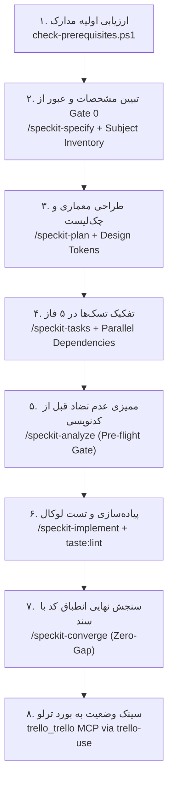

# MachineDesign Strategic Project Manager (`machinedesign-project-manager`)

اسکیل اختصاصی مدیریت راهبردی پروژه و هدایت مهندسی اکوسیستم ماشین دیزاین، با الهام از معماری‌های پیشرو جهانی (MetaGPT SOPs و `manager-skills` مهندسی):
1. **شکست ساختاریافته وظایف و هدایت Spec-Kit:** مدیریت بدون انحراف متدولوژی توسعه مشخصات‌محور (Zero Vibe Coding).
2. **اتصال و همگام‌سازی بلادرنگ به ترلو (Trello Integration via `trello-use`):** مدیریت بوردها، کارت‌ها، مایلستون‌ها و زمان‌بندی با احراز هویت مستقیم و حفظ دقیق استانداردهای ARI و منطقه زمانی تهران (`Asia/Tehran`).
3. **دکترین مصالحه و مدیریت سهمیه‌ها (Trade-off & Quota Sentinel):** حفظ سلامت سیستم سه‌گانه (سهمیه ۷۰٪ سرورهای ابری، فشرده‌سازی نودهای Neo4j و عدم افشای اسرار مهندسی).

---

## ۱. شرایط فعال‌سازی و پرامپت‌های کلیدی (Triggers)

این اسکیل به صورت خودکار یا با دستورات زیر فراخوانی می‌شود:
- «وضعیت کلی پروژه را بررسی کن»
- «قدم بعدی چیه؟ الان باید چیکار کنیم؟»
- «اسپرینت بعدی را برنامه‌ریزی کن»
- «تسک‌ها و وضعیت را به ترلو سینک کن»
- «اولویت‌بندی فیچرها و تصمیم‌گیری درباره رودمپ»
- «مدیریت و کنترل بدهی فنی و سهمیه‌های اکوسیستم»
- «آماده‌سازی پکیج استقرار برای cPanel»

---

## ۲. هدایت خودکار چرخه Spec-Kit SDD (v1.2.3)

مدیر پروژه موظف است چرخه مهندسی زیر را بدون نیاز به پرامپت دستی هدایت کند:

---

## ۳. پروتکل ارتباط با ترلو (Trello MCP via `trello-use`)

کلیه عملیات مدیریت بورد و کارت‌های ترلو باید با رعایت دقیق قوانین الزامی اسکیل [trello-use](file:///C:/Users/Admin/.gemini/config/plugins/trello/skills/trello-use/SKILL.md) اجرا شوند:

### اطلاعات پایه و شناسه‌های تاییدشده (Pre-discovered ARIs):
* **شناسه کاربر (Member ARI):** `ari:cloud:trello::user/68ac700f06331e508afb70c8` (حسین وطن‌دوست | `@hosseinvatandoust1`)
* **منطقه زمانی کاربر:** `prefs.timezone: "Asia/Tehran"` (کلیه تاریخ‌های `due` باید به UTC ISO 8601 تبدیل شوند).
* **ورک‌اسپیس رسمی:** `ari:cloud:trello::workspace/6a2a570709d3dbb1bfc805ca` (نام: `MachineDesign.ir` | URL: `https://trello.com/w/machinedesignir`)
* **بورد رسمی پروژه:** `ari:cloud:trello::board/workspace/6a2a570709d3dbb1bfc805ca/6a2a5dcd1837acd40f66054b` (نام: `MachineDesign.ir — Website Project` | URL: `https://trello.com/b/MIe4hOrM/machinedesignir-website-project`)

### نگاشت لیست‌های بورد ترلو به فازهای پروژه:
| نام لیست در ترلو | شناسه لیست (List ARI) | فاز متناظر در اکوسیستم |
| :--- | :--- | :--- |
| **📋 برنامه‌ریزی و اطلاعات پروژه** | `.../6a2a5dd6fe3303d9c581c113` | فیچرهای Spec-Kit (`spec.md`) و نقشه‌راه |
| **🎨 طراحی و معماری سایت** | `.../6a2a5dde7b1ed97901d74f23` | طرح‌های فنی (`plan.md`) و جهت‌گیری هنری Gate 0 |
| **✏️ تولید محتوا و نگارش صفحات** | `.../6a2a5de50e7256efd21b6685` | بریف‌های سئو، داده‌های Autoclaw و مقالات |
| **🖥️ توسعه فنی (HTML/CSS/JS)** | `.../6a2a5dec740b61495a866702` | تسک‌های اجرایی فعال (`tasks.md`) |
| **🖼️ تصاویر و دارایی بصری** | `.../6a2a5df3582412956db30512` | شیت‌های یکپارچه سوشیال و رندرهای سه‌بعدی شفاف |
| **🔍 تست و کنترل کیفیت** | `.../6a2a5df9f1aa7ead42f1142f` | غربال با `taste:lint` و تست ریسپانسیو `taste:inspect` |
| **🚀 انتشار و استقرار روی cPanel** | `.../6a2a5e004ca808063e252bf9` | پکیج نهایی `cpanel-deploy` و دامپ دیتابیس |
| **🔄 نگهداری و بهبود مداوم** | `.../6a2a5e0914c55a51a35b03d2` | همگرایی (`speckit-converge`)، فشرده‌سازی Neo4j و رصد ترندها |

### قوانین الزامی در فراخوانی ترلو:
1. **قانون شناسه ARI:** هرگز شناسه خام یا URL را به پارامترهای ID ندهید؛ شناسه‌ها باید فرمت کامل `ari:cloud:trello::...` باشند.
2. **قانون تاریخ سررسید (Due Date):** تاریخ‌ها همواره بر اساس زمان تهران به UTC تبدیل شوند. پیش‌فرض در صورت عدم اعلام ساعت: ۰۹:۰۰ صبح تهران (۰۵:۳۰ UTC).
3. **قانون ترتیب منظم (`pos`):** هنگام ساخت چند کارت یا چک‌لیست همزمان، از اعداد صحیح متوالی (`pos: 1`, `pos: 2`, `pos: 3`) استفاده شود.

### دکترین کانبان دوطرفه و زمان‌بندی انسانی واقع‌گرایانه (Dual Kanban & Realistic Scheduling):
1. **نمای کلان، شفاف و بدون ریزه‌کاری گیج‌کننده (High-Level Overview):**
   - کارت‌های مربوط به کارهای هوش مصنوعی باید در سطح کلان (Milestone / Feature Level) ثبت شوند تا حسین با یک نگاه سریع به ستون‌های کانبان از روند کارها مطلع شود، بدون اینکه با جزئیات کدنویسی یا جزییات فنی کلافه‌کننده شلوغ شود.
2. **مدیریت وظایف انسانی (Human Action Items / Owner: Hossein):**
   - بورد ترلو به صورت ویژه بستری است برای وظایفی که خود حسین باید شخصاً انجام دهد (مانند تست نهایی قطعات در کارگاه برج سامان، تماس‌های کلیدی، تصمیم‌گیری‌های بازرگانی، تایید نهایی طرح‌ها).
   - هنگام درخواست کاربر، این کارت‌ها در لیست مربوطه با تخصیص به حساب حسین (`ari:cloud:trello::user/68ac700f06331e508afb70c8`) ایجاد می‌شوند.
3. **زمان‌بندی انسانی واقع‌گرایانه (Realistic Capacity & Cadence):**
   - **منع فشردگی غیرعملیاتی:** زمان‌بندی‌ها باید با در نظر گرفتن ریتم واقعی زندگی، کارگاه و توان انسانی تنظیم شوند؛ از تعیین سررسیدهای فشرده پشت‌سرهم یا توهم‌آمیز اکیداً پرهیز شود.
   - **ترتیب منطقی و گام‌به‌گام (Prerequisite-First):** وظایف باید دارای تقدم و تاخر منطقی و اجرایی باشند (پرهیز از توالی‌های تصادفی یا شروع کارهای وابسته قبل از اتمام پیشنیاز).
   - **حذف اتلاف وقت و زمان مرده (Zero-Idle Drag):** وظایف به گونه‌ای هماهنگ چیده شوند که زنجیره ارزش قطع نشود و وقت پرت میان‌فازی به حداقل برسد.
   - **ساعت پیش‌فرض کاری:** سررسیدها در صورت عدم تعیین ساعت دقیق، بر روی ساعت ۱۰:۰۰ صبح یا ۱۶:۰۰ عصر به وقت تهران (`Asia/Tehran`) تنظیم شوند تا با ساعات کاری واقعی هماهنگ باشد.

---

## ۴. حکمرانی سه‌گانه و موازنه تصمیم‌گیری (Governance & Trade-offs)

مدیر پروژه بر ۳ ستون اکوسیستم نظارت فعال دارد:

1. **ستون اول (وب‌سایت ماشین دیزاین):**
   - اولویت ۱۰۰٪ با قابلیت‌های بومی وردپرس بدون پلاگین‌های سنگین (Ponytail Doctrine).
   - رعایت سخت‌گیرانه قوانین تقارن بصری (Split & Baseline Symmetry با انحراف ۰.۰۰ پیکسل).
   - ممنوعیت مطلق کدهای بدون تست لوکال و بدون عبور از لینتر `taste:lint`.

2. **ستون دوم (رادار ترند و گراف دانش آینده‌پژوهی):**
   - **پاسداری از سقف ساب‌ریکوئست‌ها:** همواره زیر ۴۴ از ۵۰ در کرون‌جاب‌های کلودفلیر.
   - **قانون بهره‌وری ۷۰٪ سهمیه‌ها:** سقف ۷۰ کوئری روزانه در Serper.dev با کش ۷ روزه در KV.
   - **سلامت گراف Neo4j:** اجرای دوره‌ای میرایی EWMA و فشرده‌سازی نودهای متروکه با `sync_radar_to_neo4j.py --compact`.

3. **ستون سوم (موتور محتوا و سوشیال مدیا):**
   - انتشار اولیه در بافر (`hosseinvatandoust699@gmail.com`) با تگ مشارکتی.
   - **حفظ اسرار تجاری مهندسی:** عدم افشای نقشه‌های داخلی، کالبدشکافی مکانیسم یا نسبت دنده‌ها.
   - پایبندی به محل رسمی دفتر و کارگاه: منحصراً **مشهد، برج سامان**.

---

## ۵. ماتریس تصمیم‌گیری و اولویت‌بندی تسک‌ها (Decision Framework)

هنگام مواجهه با چند تسک یا درخواست همزمان، مدیر پروژه از فرمول اولویت‌بندی زیر استفاده می‌کند:

$$\text{Priority Score} = \frac{\text{Business Value (1..5)} \times \text{Confidence (1..5)}}{\text{Effort (1..5)} \times \text{Technical Debt Risk (1..3)}}$$

* **امتیاز بالا ($\ge 3.0$):** فوراً وارد فاز اسناد و اجرای سریع در اسپرینت جاری می‌شود.
* **امتیاز متوسط ($1.5 - 2.9$):** در بورد ترلو در لیست `📋 برنامه‌ریزی` قرار می‌گیرد.
* **امتیاز پایین ($< 1.5$):** به عنوان ایده آینده ثبت شده و فعلاً از مصرف زمان تیم جلوگیری می‌شود.
