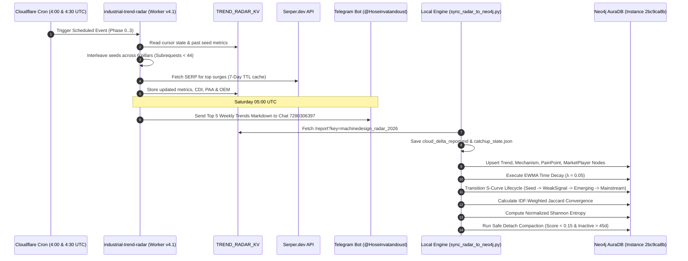

# Architecture Implementation Plan: Industrial Trend Radar & Foresight Knowledge Graph

**Feature Branch**: `003-industrial-trend-radar`  
**Status**: Active in Production (v4.1-ArgonAudit)  
**Spec Reference**: [specs/003-industrial-trend-radar/spec.md](spec.md) | [TREND_RADAR_TECHNICAL_SPEC.md](file:///D:/Antigravity/trend_radar/TREND_RADAR_TECHNICAL_SPEC.md)

---

## ۱. نقشه اجزا و معماری سیستم (System Component Blueprint)

```text
D:\Antigravity\trend_radar\
├── TREND_RADAR_TECHNICAL_SPEC.md  # سند جامع فنی و معماری ممیزی‌شده توسط آرگون (v4.1)
├── cloudflare_worker/
│   ├── worker.js                  # کدهای هسته ورکر کلودفلیر v4.1، فازبندی لایه‌ای، CDI، اتصال به Serper و تلگرام
│   ├── build_worker_140.py        # اسکریپت بیلد و تجمیع ورکر با ۱۴۰ بذر صنعتی
│   └── deploy_worker.py           # اسکریپت استقرار ابری ورکر از طریق Cloudflare API
├── neo4j_engine/
│   ├── setup_schema.py            # ایجاد ۷ کانسترینت یکتا و ایندکس تمام‌متن در Neo4j AuraDB
│   └── sync_radar_to_neo4j.py     # پایپ‌لاین همگام‌سازی ابری و اجرای ۵ مدل ریاضی سمت سرور
├── seeds_140.json                 # ۱۴۰ بذر صنعتی استاندارد تفکیک‌شده بر اساس ۶ ستون خدمات
├── check_weekly_catchup.py        # اسکریپت همگام‌سازی سریع هفتگی لوکال
├── catchup_state.json             # فایل وضعیت و کش محلی آخرین بررسی هفته
├── cloud_delta_report.md          # گزارش تحلیلی ذخیره‌شده محلی
└── trends_ledger.db               # دفترکل SQLite نگهداری تاریخچه ترندها
```

---

## ۲. جریان پردازش جامع هیبریدی (End-to-End Processing Flow)



---

## ۳. شاخص‌های پایش و مقادیر آستانه (SLAs & Thresholds)

- **زمان اجرای ورکر**: حداکثر ۱۰ ثانیه در پردازش ابری رایگان کلودفلیر.
- **سقف مصرف Serper**: حداکثر ۷۰ کوئری روزانه (قانون بهره‌وری حداکثری از سهمیه‌های رایگان).
- **نیمه‌عمر میرایی نمایی**: $T_{half} = 13.86$ روز با ضریب $\lambda = 0.05$.
- **آستانه هیسترزیس چرخه عمر**: صعود در امتیاز $\ge 0.65$ و نزول در امتیاز $< 0.45$.
- **پاکسازی دوره‌ای نودهای متروکه**: حذف ایمن نودهای با امتیاز $< 0.15$ و عدم فعالیت بیش از ۴۵ روز.
