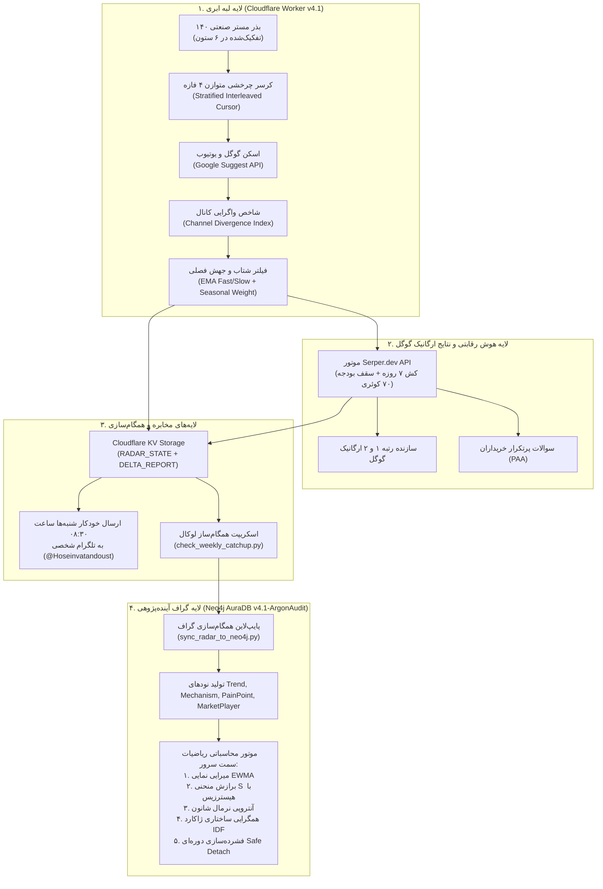

# Feature Specification: Industrial Trend Radar & Foresight Knowledge Graph (موتور رادار ترند و گراف دانش آینده‌پژوهی صنعتی)

**Feature Branch**: `003-industrial-trend-radar`  
**Created**: 2026-10-29 | **Updated**: 2026-11-01  
**Status**: Active in Production (v4.1-ArgonAudit)  
**Input Reference**: [D:\Antigravity\trend_radar\TREND_RADAR_TECHNICAL_SPEC.md](file:///D:/Antigravity/trend_radar/TREND_RADAR_TECHNICAL_SPEC.md)

---

## ۱. اهداف تجاری و معماری کلان سه‌لایه‌ای (3-Tier Hybrid Architecture)

سیستم رادار ترندهای صنعتی و آینده‌پژوهی ماشین دیزاین، یک زیرساخت ترکیبی پیشرفته شامل لبه ابری، هوش رقابتی موتورهای جستجو و پایگاه دانش گرافی است که جهت **کشف نیازهای فناورانه کارخانجات، عیب‌یابی ارتعاشاتی و خطوط تولید، پایش تجهیزات وارداتی و هدایت هدفمند خدمات ۶ گانه مهندسی** توسعه یافته است:

---

## ۲. مشخصات عملکردی لایه‌ها

### ۱. لایه اول: ورکر لبه ابری کلودفلیر (Cloudflare Edge Worker v4.1)
- **ورکر ابری**: `industrial-trend-radar` در `https://industrial-trend-radar.hosseinvatandoust699.workers.dev`
- **کلید احراز هویت API**: `machinedesign_radar_2026`
- **پایگاه داده KV**: `TREND_RADAR_KV` با شناسه `1b9878760547449cab280666ba30604d`
- **چرخه کرون‌جاب‌ها**:
  - اسکن متوازن روزانه در دو نوبت: `0 4 * * *` و `30 4 * * *` (UTC).
  - ارسال گزارش هفتگی به تلگرام: `0 5 * * 6` (شنبه‌ها ساعت ۰۸:۳۰ صبح تهران به Chat ID `7280306397`).
- **کرسر چرخشی متوازن ۴ فازه (Stratified Interleaved Cursor)**:
  - فاز ۰: ۳۸ بذر (~۴۳ ساب‌ریکوئست) | فاز ۱: ۳۵ بذر (~۳۹ ساب‌ریکوئست)
  - فاز ۲: ۳۴ بذر (~۳۶ ساب‌ریکوئست) | فاز ۳: ۳۳ بذر (~۴۱ ساب‌ریکوئست)
  - تضمین قطعی حفظ ساب‌ریکوئست‌ها زیر ۴۴ (سقف مجاز: ۵۰) و اسکن ۱۰۰٪ بذرها ظرف ۴۸ ساعت بدون گرسنگی آماری ۶ ستون.
- **فرمول شاخص واگرایی کانال (Channel Divergence Index - CDI)**:
  $$CDI = \frac{V_{web} - V_{yt}}{V_{web} + V_{yt} + 0.001}$$
  - $CDI \ge 0.35$: نیت خرید سرمایه‌ای کارخانجات (`CAPEX_PROCUREMENT`).
  - $CDI \le -0.35$: نیت فنی، تعمیراتی و کارگاهی (`KINEMATICS_MAINTENANCE`).
  - بینابین: طغیان فراگیر بازار (`FULL_MARKET_SURGE`).

### ۲. لایه دوم: هوش رقابتی ارگانیک SERP (Serper.dev)
- **کلید فعال**: متغیر محیطی `SERPER_API_KEY` در `.env`.
- **مدیریت سهمیه (70% Quota Rule)**: حداکثر ۷۰ کوئری روزانه معادل ۷۰ الی ۹۰ درصد مصرف سهمیه رایگان.
- **کش هوشمند ۷ روزه (7-Day TTL Cache)**: ذخیره نتایج در کلید `serp` دیتابیس KV جهت جلوگیری از سوزاندن توکن برای کوئری‌های تکراری.
- **استخراج داده‌های عینی**: سازنده رتبه ۱ و ۲ گوگل و سوالات پرتکرار خریداران در People Also Ask (PAA).

### ۳. لایه سوم: گراف دانش آینده‌پژوهی در Neo4j AuraDB (ممیزی و تایید آرگون)
- **اینستنس فعال**: `2bc9ca8b` (`neo4j+s://2bc9ca8b.databases.neo4j.io`).
- **هستی‌شناسی و کانسترینت‌های یکتا (7 Unique Constraints)**:
  1. `(t:Trend).canonical_id`
  2. `(p:Pillar).id` و `(p:Pillar).name`
  3. `(d:MacroDriver).id`
  4. `(m:Mechanism).canonical_id`
  5. `(pp:PainPoint).id`
  6. `(mp:MarketPlayer).domain`
- **ایندکس تمام‌متن (Full-Text Index)**: ایندکس `trend_alias_ft` بر روی `[t.name, t.aliases]` جهت ادغام هوشمند مترادف‌ها و پیشگیری از نودهای تکراری.

---

## ۳. سوییت پنج مدل ریاضی مستقر در سرور Neo4j (Server-Side Cypher Math Models)

1. **میرایی نمایی زمان و ممنتوم پویا (EWMA Time Decay)**:
   $$W(t) = W_0 \cdot e^{-\lambda \cdot \Delta t} \quad (\lambda = 0.05 \text{ day}^{-1}, \, T_{half} \approx 14 \text{ days})$$
   - کاهش وزن سیگنال‌های قدیمی در صورت عدم تکرار و تقویت ترندهای مستمر.
2. **منحنی S لاجستیک با حافظه پسماند (Hysteresis S-Curve Lifecycle)**:
   - مراحل گذار: `Seed` $\rightarrow$ `WeakSignal` $\rightarrow$ `EmergingTrend` $\rightarrow$ `Mainstream`.
   - استفاده از آستانه دوگانه برای صعود ($0.65$) و نزول ($0.45$) جهت جلوگیری از لرزش وضعیت نودها در مرزها.
3. **همگرایی ساختاری ژاکارد با وزن‌دهی معکوس فرکانس (IDF-Weighted Jaccard Convergence)**:
   - کشف همگرایی بین مکانیزم‌ها، دردهای کارگاهی و ستون‌های خدمات بر پایه هم‌پوشانی ارتباطات در گراف.
4. **آنتروپی نرمال شانون (Normalized Shannon Entropy)**:
   $$H_{norm}(t) = -\frac{1}{\ln(6)} \sum_{i=1}^{6} p_i \ln(p_i)$$
   - اندازه‌گیری میزان عمومیت یک فناوری یا مکانیزم بین ۶ ستون خدمات ماشین دیزاین ($H_{norm} \approx 1$ نشانگر فناوری افقی فراگیر و $H_{norm} \approx 0$ نشانگر فناوری فوق‌تخصصی عمودی).
5. **پروتکل فشرده‌سازی و حذف ایمن پیوندها (Safe Detach Delete Compaction)**:
   - آرشیو و حذف ایمن نودهای ضعیف متروکه ($score < 0.15$ بدون فعالیت بیش از ۴۵ روز) جهت حفظ سلامت و بهره‌وری پایگاه داده.

---

## ۴. رابط خط فرمان و ابزارهای توسعه (CLI & Skills Integration)

- ماژول اختصاصی پایپ‌لاین: [sync_radar_to_neo4j.py](file:///D:/Antigravity/trend_radar/neo4j_engine/sync_radar_to_neo4j.py)
- سوییچ‌های اجرایی:
  - `python sync_radar_to_neo4j.py --sync-all`: واکشی دلتا از کلودفلیر و همگام‌سازی کامل با Neo4j.
  - `python sync_radar_to_neo4j.py --decay`: اجرای رویه میرایی نمایی EWMA روی تمامی سیگنال‌ها.
  - `python sync_radar_to_neo4j.py --lifecycle`: به‌روزرسانی وضعیت فاز چرخه عمر بر اساس منحنی S.
  - `python sync_radar_to_neo4j.py --convergence`: محاسبه وزن یال‌های همگرایی ژاکارد.
  - `python sync_radar_to_neo4j.py --compact`: پاکسازی ایمن نودهای مرده و ارتقای عملکرد گراف.
- ادغام مستقیم در اسکیل‌های رسمی:
  - `machinedesign-trend-radar` (v4.1 با سوییچ `--sync-neo4j`)
  - `neo4j-graph-navigator` (v4.1-ArgonAudit)

---

## ۵. سناریوهای آزمون و تایید کیفیت (Acceptance QA)

1. **آزمون فازهای کرسر و ساب‌ریکوئست‌ها:** در هر اجرای ورکر کلودفلیر، تعداد کل ساب‌ریکوئست‌ها از ۴۴ عبور نکند.
2. **آزمون کش SERP:** کوئری‌های تکراری در فاصله کمتر از ۷ روز نباید سهمیه جدیدی از Serper مصرف کنند.
3. **آزمون یکپارچگی گراف Neo4j:** اجرای اسکریپت `setup_schema.py` هر ۷ کانسترینت و ایندکس تمام‌متن را بدون خطا فعال کند.
4. **آزمون میرایی EWMA:** نودهای قدیمی‌تر از ۱۴ روز بدون سیگنال جدید، نمره وزن‌دارشان دقیقاً به نصف کاهش یابد.
