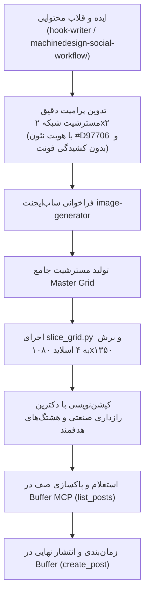

# Architecture Implementation Plan: Social Media & Multi-Channel Content Engine

**Feature Branch**: `004-social-media-content-engine`  
**Status**: Active in Production

---

## ۱. ساختار دارایی‌ها و جریان فایل‌ها (Asset Structure)

```text
D:\Machinedesign.ir\machinedesign-social-assets\campaigns\launch-dumpling-series\
├── 01_source_material\
│   ├── images\
│   │   ├── konbrit_150_canonical_reference.jpg       # تصویر مرجع کانونیکال دستگاه
│   │   ├── konbrit_150_rotary_molds_mounted.jpg      # عکس واقعی قالب روتاری نصب‌شده
│   │   └── konbrit_150_rotary_molds_isolated.jpg     # عکس واقعی قالب روتاری مجزا
│   └── product_data.json                             # مشخصات فنی تمیز و مهندسی دستگاه
├── 02_generated_visuals\
│   ├── carousel_dough\                               # خروجی اسلایدهای خمیر و غلتک استیل
│   ├── carousel_molds\                               # خروجی اسلایدهای قالب‌های برنجی روتاری
│   └── carousel_early_bird\                          # خروجی آفرهای ویژه پیش‌خرید
├── 03_video_reels\
│   ├── dm80_pelmeni_machine_persian_dubbed.mp4       # ویدیوی دوبله‌شده با smart-video-dubbing
│   └── reel_01_complete_automation_kbdm150.mp4       # ریلز اختصاصی کارگاهی
└── slice_grid.py                                     # اسکریپت برش مسترشیت به اسلایدهای ۱۰۸۰×۱۳۵۰
```

---

## ۲. پایپ‌لاین تولید و انتشار اسلایدها (Workflow Pipeline)



---

## ۳. شاخص‌های کیفی و انطباق فنی (Quality Metrics)

- **نسبت تصویر**: دقیقاً نسبت ۴:۵ (۱۰۸۰×۱۳۵۰ پیکسل) برای کاروسل‌ها و ۹:۱۶ (۱۰۸۰×۱۹۲۰ پیکسل) برای استوری‌ها.
- **تایپوگرافی**: فونت وزیرمتن با خوانایی بالا در نسخه موبایل بدون غلط املایی یا حروف بریده.
- **تگ همکار**: تگ حساب `@machinedesign.ir` در اسلاید ۱ در موقعیت `(x: 0.5, y: 0.5)`.
