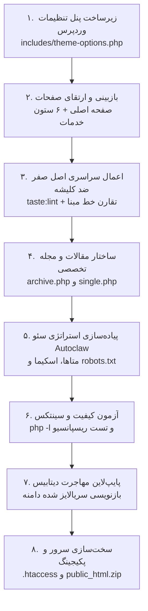

# Implementation Plan: Full Production Readiness & cPanel Deployment

**Branch**: `005-pre-launch-deploy` | **Date**: 2026-11-01 | **Spec**: [specs/005-pre-launch-deploy/spec.md](file:///D:/Antigravity/specs/005-pre-launch-deploy/spec.md)

**Input**: Feature specification from `specs/005-pre-launch-deploy/spec.md`  
**Role / Architect**: `machinedesign-project-manager`  
**Target Host**: cPanel Shared/Cloud Hosting | **Domain**: `https://machinedesign.ir`  
**Deploy Bundle Destination**: `D:\Machinedesign.ir\cpanel-deploy\`

---

## ۱. خلاصه معماری و رویکرد جامع (Comprehensive Architecture & Approach)

برای رساندن وب‌سایت ماشین دیزاین به یک پروداکشن بی‌نقص و مستقل، طرح پیاده‌سازی شامل ۶ ستون مهندسی یکپارچه است که به صورت گام‌به‌گام و با ترتیب پیش‌نیازها اجرا می‌شود:



---

## ۲. مشخصات معماری اجزا (Component Architecture)

### ۲.۱. پنل تنظیمات تم وردپرس (`includes/theme-options.php`):
- پیاده‌سازی با استفاده از Settings API بومی وردپرس (بدون نیاز به پلاگین‌های سنگین مانند Redux یا ACF).
- ثبت صفحه زیرمنوی `تنظیمات ماشین دیزاین` ذیل منوی `نمایش` (Appearance) یا منوی سطح بالا با آیکون چرخ‌دنده مهندسی.
- بخش‌های تنظیمات (Settings Sections):
  1. **اطلاعات پایه و کارگاهی:** آدرس دفتر مرکزی و کارگاه مشهد (برج سامان، میدان جانباز)، تلفن ثابت، شماره واتساپ/تماس مستقیم، ایمیل رسمی کارفرما.
  2. **شبکه‌های اجتماعی:** پیج بیزینسی اینستاگرام (`@machinedesign.ir`)، پیج شخصی (`@h.vatan.doust`)، بات و کانال تلگرام (`@machinedesign_ir`)، کانال یوتیوب.
  3. **آمارهای کلیدی داشبورد:** تعداد متخصصان کادر (پیش‌فرض ۱۶)، تعداد پروژه‌های موفق، ماشین‌آلات طراحی‌شده، درصد رضایت مشتریان صنعتی.
  4. **تنظیمات تله‌متری و استعلام (RFQ):** ایمیل مقصد جهت ارسال اطلاعیه‌ها، توکن وب‌هوک تلگرام جهت ارسال بلادرنگ لیدها به تلگرام شخصی حسین.
  5. **متادیتاهای سئو و وبمستر:** کد متاتگ Google Search Console، کد تایید وبمستر بینگ، لینک تصویر پیش‌فرض اشتراک‌گذاری شبکه‌های اجتماعی (1200x630).
- تابع کمکی استاندارد برای کل قالب:
  ```php
  function md_get_option( $key, $default = '' ) {
      $options = get_option( 'machinedesign_theme_options', array() );
      return ! empty( $options[ $key ] ) ? $options[ $key ] : $default;
  }
  ```

### ۲.۲. بازبینی و پیوستگی صفحات ۶ ستون خدمات:
- **Pillar 1:** `page-machine-design.php` — طراحی ماشین‌آلات و خطوط تولید (تمرکز بر صنایع غذایی، بسته‌بندی، مکانیزم‌ها، کانوایر، DFMA و بومی‌سازی).
- **Pillar 2:** `page-factory-troubleshooting.php` — مشاوره فنی و عیب‌یابی کارخانجات (توقف خط، تحلیل ارتعاشات، یاتاقان‌ها، فرآیند، متالورژی و ایمنی ISO 12100).
- **Pillar 3:** `page-rd-prototyping.php` — مشاوره سازمانی و تحقیق و توسعه (ساخت پروتوتایپ، DFMEA، امکان‌سنجی خطوط تولید).
- **Pillar 4:** `page-engineering-mentorship.php` — آموزش و منتورشیپ فردی (سالیدورک پیشرفته، شبیه‌سازی FEA با Ansys، تلرانس‌گذاری GD&T).
- **Pillar 5:** `page-corporate-training.php` — آموزش سازمانی کارخانه‌ها (ارتقای تیم‌های فنی در محل کارخانه، نقشه‌خوانی، استانداردسازی).
- **Pillar 6:** `page-machinery-inspection.php` — مشاوره و کارشناسی خرید ماشین‌آلات (خرید از چین/دبی، دستگاه‌های دست‌دوم، تدوین RFQ و قرارداد).
- **اتصال متقابل:** پیوند مستقیم تمامی صفحات خدمات به فرم استعلام RFQ (`page-contact.php?service=...`) به گونه‌ای که با کلیک کاربر، فیلد سرویس در فرم استعلام به صورت خودکار انتخاب شود.

### ۲.۳. پالایش اصل صفر ضد کلیشه (Gate 0 Refactoring):
- حذف کلاس‌های کیکر/تگ تزئینی (`.section-tag`) که بالای تیترها قرار دارند و تبدیل آنها به تیترهای سلسله‌مراتبی مهندسی و تمیز.
- حذف شماره‌گذاری‌های نمایشی (نظیر `>01<`, `>02<`, `>03<`) که کلیشه رایج طراحی‌های مصنوعی هوش مصنوعی است.
- اصلاح کادرهای خط باریک (1px Border Soup) و جایگزینی با تفاوت تن رنگ سطوح اسلیت تیره (`#121824` به `#1c2536`).
- حذف گرادیان‌های متنی (`background-clip: text`) و جایگزینی با رنگ‌های تخت با کنتراست بالا.
- تثبیت تقارن عمودی خط مبنا (Baseline Symmetry) با انحراف ۰.۰۰ پیکسل در تمام ستون‌های موازی.

### ۲.۴. معماری وبلاگ، مقالات و پایگاه دانش مهندسی (Blog / Insights):
- ساخت تمپلیت آرشیو مقالات (`archive.php` یا `page-insights.php`):
  - فیلتر تب‌بندی بر اساس ۶ ستون خدمات.
  - نمایش کارت‌های مقالات با زمان مطالعه، تاریخ به‌روزرسانی شمسی، تصویر شاخص بهینه و بدون حاشیه‌های معلق غیرضروری.
- ساخت تمپلیت تک مقاله مهندسی (`single.php`):
  - فهرست مطالب شناور (Table of Contents).
  - بلوک کد و استانداردهای صنعتی با قلم مونو JetBrains Mono.
  - باکس نویسنده متصل به پروفایل ۱۶ مهندس در CPT `team_member`.
  - باکس اقدام به عمل (CTA) جهت استعلام فنی در پایان هر مقاله.
- ایجاد مقالات ستون‌ساز (Cornerstone) متناظر با واژه‌های دارای بالاترین امتیاز در فایل Autoclaw.

### ۲.۵. پیاده‌سازی سئو بر مبنای داده‌های Autoclaw:
- خواندن متادیتاها از:
  - `D:\Machinedesign.ir\Autoclaw\Final_SEO_Strategy_Report_Local (2).csv`
  - `D:\Machinedesign.ir\Autoclaw\SEO_Content_Plan_Final.csv`
- تزریق ساختاریافته در `header.php` یا هوک‌های سئوی بومی:
  - متاتگ‌های داینامیک `title`, `description`, `canonical`, `og:title`, `og:description`, `og:image`.
  - کدهای اسکیما Schema.org JSON-LD شامل `Organization`, `ProfessionalService`, `ContactPage`, `AboutPage`, `Article`, `BreadcrumbList`.
  - تولید فایل استاندارد `robots.txt` و اتصال به `sitemap.xml`.

### ۲.۶. پایپ‌لاین مهاجرت، سخت‌سازی و استقرار:
- اسکریپت پایتون `migrate_db_serialized.py` جهت بازنویسی بایت‌های سریالایز شده و اصلاح آدرس‌های `http://localhost/machinedesign` به `https://machinedesign.ir`.
- فایل سرور `.htaccess` با فورس HTTPS، ریدایرکت non-www، فشرده‌سازی Gzip و کش ۱ ساله مرورگر.
- فایل پروداکشن `wp-config-production.php` با کلیدهای امنیتی تازه و قطع خطاهای عمومی.
- اسکریپت `package_deploy.py` جهت ساخت `public_html.zip` سبک و پاکیزه در `D:\Machinedesign.ir\cpanel-deploy\`.

---

## ۳. نگاشت به تسک‌های اجرایی (Mapping to Tasks)

کلیه این ابعاد در سند تسک‌ها (`tasks.md`) در ۱۰ فاز منطقی و متوالی کدگذاری می‌شوند تا هیچ جزئی از قلم نیفتد.
