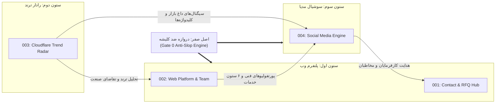

# داشبورد جامع و ثبت فیچرهای اسپک‌کیت (Spec-Kit Master Ecosystem Dashboard)

**سیستم مدیریت:** Spec-Driven Development (SDD) | **قانون اساسی مرجع:** `constitution.md` (v2.1.0)  
**دامنه و برند:** `machinedesign.ir` | **روت اصلی کارگاه:** `D:\Antigravity\` | **پلتفرم وب:** `C:\xampp\htdocs\machinedesign\`

---

## ۱. نقشه جامع فیچرهای اکوسیستم (Unified Feature Registry)

| شناسه فیچر | نام و حوزه عملیاتی | وضعیت | اسناد و مشخصات | مسیر فایل‌های اجرایی |
| :---: | :--- | :---: | :---: | :--- |
| **`000`** | **نظام ضد کلیشه و اسلاپ هوش مصنوعی (Gate 0 Anti-Slop Engine)** | فعال و الزامی | [Constitution Art. 2](constitution.md#۲-اصل-بنیادین-صفر-نظام-ضد-کلیشه-و-منع-مطلق-اسلاپ-هوش-مصنوعی-gate-0-anti-slop--anti-cliché-law) | `taste-lint.bat`, `taste-inspect.bat`, `package.json` |
| **`001`** | **مرکز جامع تماس و استعلام صنعتی (Contact & RFQ Hub)** | آماده استقرار | [Spec & Plan](001-contact-and-rfq-hub/spec.md) | `wp-content/themes/hello-elementor/page-contact.php` |
| **`002`** | **پلتفرم وب مهندسی و کادر ۱۶ نفره (Web Platform & Team Roster)** | تکمیل و دیپلوی | [Spec & Plan](002-web-platform-and-team/spec.md) | `page-team.php` و ریتم متناوب در `style.css` |
| **`003`** | **موتور رادار ترند و گراف آینده‌پژوهی صنعتی (Trend Radar & Neo4j v4.1)** | فعال در پروداکشن | [Spec & Plan](003-industrial-trend-radar/spec.md) | `trend_radar/`, Cloudflare Worker و Neo4j AuraDB |
| **`004`** | **موتور محتوا و شبکه‌های اجتماعی (Social Media & Content Engine)** | فعال در پروداکشن | [Spec & Plan](004-social-media-content-engine/spec.md) | `machinedesign-social-assets\` و Buffer MCP |
| **`005`** | **آماده‌سازی جامع پروداکشن و استقرار روی cPanel (Full Production & cPanel Deployment)** | در حال پیاده‌سازی (فاز ۱ تکمیل: ۱۶/۵۲ تسک) | [Spec, Plan & Tasks](005-pre-launch-deploy/spec.md) | `includes/theme-options.php` و پکیج‌های نهایی |

---

## ۲. هم‌افزایی ساختاری سه ستون اکوسیستم تحت اصل صفر (Gate 0)

---

## ۳. راهنمای چرخه کار (SDD Commands Quickstart)

برای توسعه یا اصلاح در هر یک از بخش‌های فوق:
- **Gate 0 Verification**: اجرای `npm run taste:lint` یا `.\taste-lint.bat` جهت اطمینان از عدم وجود کدهای کلیشه‌ای و اسلاپ
- **/speckit-specify**: تدوین یا به‌روزرسانی الزامات در `specs/<feature>/spec.md` همراه با Subject Inventory و One Live Thing
- **/speckit-plan**: طراحی معماری، نقشه‌ها و ممیزی Gate 0 در `specs/<feature>/plan.md`
- **/speckit-tasks**: صدور فهرست تسک‌های وابسته‌محور در `specs/<feature>/tasks.md`
- **/speckit-implement**: پیاده‌سازی و تست بدون باگ و سینک با دیپلوی

**نسخه رجیستری:** 2.1.0 | **آخرین به‌روزرسانی:** 2026-11-01
