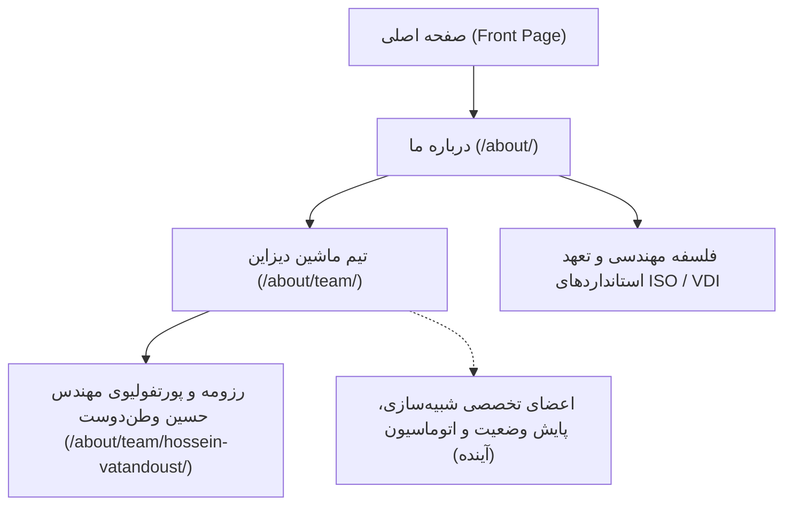

# SPEC: معماری و صفحات درباره ما، تیم ماشین دیزاین و پورتفولیوی مهندسی

**وضعیت:** مصوب (Approved)  
**فاز توسعه:** توسعه لایه‌های هویتی و پرسنلی (About, Team & Portfolio)  
**دامنه:** MachineDesign.ir  
**تاریخ تدوین:** ۲۷ اکتبر ۲۰۲۶  

---

## ۱. هدف و چشم‌انداز (Executive Objective)
ایجاد ساختار سلسله‌مراتبی، حرفه‌ای و منطبق با دیزاین‌سیستم سایبری-مکانیکی برای بخش «درباره ما» در وب‌سایت ماشین دیزاین، به گونه‌ای که:
1. **صفحه اصلی درباره ما (`/about/`):** روایتگر هویت، مأموریت، فلسفه مهندسی (پیوند علم تئوری با کف کارگاه و متدولوژی DFMA) و ظرفیت‌های جامع دفتر ماشین دیزاین باشد و صرفاً به یک فرد محدود نگردد.
2. **زیرصفحه تیم ماشین دیزاین (`/about/team/`):** ویترین معرفی تیم نخبگان، دپارتمان‌های طراحی، شبیه‌سازی FEA، ساخت و بازرسی با کارت‌های تعاملی شامل تصویر آواتار، عنوان سمت، تخصص‌ها، بایو خلاصه و لینک مستقیم ورود به رزومه جامع هر عضو.
3. **زیرصفحه پورتفولیو و رزومه کامل مهندسی حسین وطن‌دوست (`/about/team/hossein-vatandoust/`):** برگردان کامل و تعاملی رزومه ۳ صفحه‌ای رسمی (شامل ۱۵ سال سابقه اجرایی، مدل‌های GrabCAD، تسلط بر نرم‌افزارهای CAD/CAM، تلفیق تفکر مدیریتی MBA با ساخت و تولید، پروژه‌های شاخص از خطوط پلاستیک تا دستگاه زعفران).

---

## ۲. ساختار آدرس‌ها و سلسله‌مراتب صفحات (Information Architecture & Permalinks)

- **صفحه مادر:** `/about/` (Page ID 11) -> قالب اختصاصی `page-about.php`
- **زیرصفحه ۱:** `/about/team/` -> Page Slug: `team`, Parent: 11 (`about`) -> قالب اختصاصی `page-team.php`
- **زیرصفحه ۲:** `/about/team/hossein-vatandoust/` -> Page Slug: `hossein-vatandoust`, Parent: `team` -> قالب اختصاصی `page-profile-hossein.php`

---

## ۳. نیازمندی‌های محتوایی و عملکردی صفحات (Content & Feature Specifications)

### ۳.۱. صفحه اصلی درباره ما (`page-about.php`)
- **سکشن ۱: هیرو شرکتی و هویت برند:**
  - بج نئونی: `ENGINEERING IDENTITY // SINCE 2011`
  - تیتر دو سطحی: مهندسی ماشین‌آلات صنعتی؛ پیوند دانش آکادمیک با واقعیت‌های اجرایی کف کارگاه
  - مانیفست ماشین دیزاین: چرایی شکل‌گیری، مأموریت در صنعت کشور و حذف آزمون‌وخطاهای پرهزینه در ماشین‌سازی.
- **سکشن ۲: نوار آمار و اعتبار صنعتی (Stats Strip):**
  - ۱۵+ سال تجربه میدانی | ۵۰+ پروژه موفق صنعتی | ۸۵٪ کاهش هزینه دوباره‌کاری با DFMA | ۱۰۰٪ تعهد محرمانگی NDA
- **سکشن ۳: ارکان و مأموریت مهندسی (Core Engineering Pillars):**
  - رویکرد طراحی برای ساخت و مونتاژ اقتصادی (DFMA)
  - انطباق با استانداردهای جهانی (DIN, ISO 12100, ASME Y14.5, VDI 2221)
  - نظارت میدانی در کارگاه و تحویل بدون لرزش
- **سکشن ۴: راه‌های هدایت به زیرصفحات (Sub-Page Navigation Grid):**
  - کارت بزرگ معرفی و ورود به «تیم ماشین دیزاین و متخصصان ارشد»
  - کارت استانداردهای فنی و پروتکل محرمانگی اطلاعات کارخانجات
  - کارت بازدید از خدمات شش‌گانه مهندسی
- **سکشن ۵: دعوت به اقدام (CTA) و ارتباط مستقیم با سرپرست دفتر فنی.**

---

### ۳.۲. زیرصفحه تیم ماشین دیزاین (`page-team.php`)
- **سکشن ۱: هیرو تخصصی تیم:**
  - تگ: `MULTIDISCIPLINARY ENGINEERING TEAM`
  - تیتر: تیمی از نخبگان ساخت و تولید، شبیه‌سازی دینامیکی و حل مسئله صنعتی
  - چکیده: معرفی رویکرد کار تیمی مهندسی با تقسیم وظایف بین طراحان ارشد، تحلیل‌گران FEA و متخصصان میدانی.
- **سکشن ۲: کارت‌های تعاملی اعضای تیم (Team Roster Grid):**
  - **کارت ۱: مهندس حسین وطن‌دوست (Founder & Lead Industrial Designer):**
    - تصویر آواتار صنعتی با قاب Cyber-HUD.
    - تگ وضعیت: `FOUNDER // SENIOR MECHANICAL DESIGNER // MBA`
    - تیتر تخصص: مهندس مکانیک ساخت و تولید، دانش‌آموخته MBA، طراح ارشد خطوط پیوسته و مکانیزم‌های خاص.
    - بیوگرافی خلاصه: ۱۵ سال فعالیت میدانی از اکتشاف معدن و خطوط لوله تا خطوط اکستروژن و بسته‌بندی؛ تلفیق دید مهندسی با تصمیم‌گیری اقتصادی.
    - اکشن‌ها: دکمه برجسته «مشاهده رزومه و پورتفولیوی کامل مهندسی ←» (کلیک روی عکس یا دکمه به آدرس `/about/team/hossein-vatandoust/` منتقل می‌شود).
  - **کارت ۲: سرپرست دپارتمان شبیه‌سازی FEA و آنالیز المان محدود**
  - **کارت ۳: سرپرست دپارتمان پایش وضعیت ارتعاشات و الاینمنت لیزری**
  - **کارت ۴: سرپرست دپارتمان اتوماسیون صنعتی، PLC و مکاترونیک**
- **سکشن ۳: همکاری با نخبگان دانشگاهی و کارشناسان صنایع:** توضیح ساختار همکاری پروژه‌محور با اساتید دانشگاه‌های تهران و فردوسی.
- **سکشن ۴: پنل استعلام سریع و رزرو جلسه فنی با سرپرستان دپارتمان‌ها.**

---

### ۳.۳. صفحه رزومه و پورتفولیوی مهندس حسین وطن‌دوست (`page-profile-hossein.php`)
- **سکشن ۱: هیرو پروفایل شخصی و راه‌های تماس فوری:**
  - آواتار پرسنلی در قاب شش‌ضلعی/سایبری با نور سبز نئون.
  - تیتر: مهندس حسین وطن‌دوست | طراح ارشد صنعتی و ماشین‌آلات | دانش‌آموخته MBA.
  - نوار اطلاعات ارتباطی مستقیم: شماره تماس (`۰۹۳۵۸۶۸۹۸۲۹`)، ایمیل رسمی، موقعیت (مشهد)، لینک GrabCAD (`grabcad.com/hossein.vatandoust-1/models`).
- **سکشن ۲: بیانیه مزیت رقابتی (The MBA & Dual-Capability Hook):**
  - ۱۵ سال تجربه میدانی و طراحی در قالب یک مهندس واحد و چندمهارتی.
  - چرایی ارزش‌آفرینی MBA برای پروژه‌های صنعتی: تحلیل هزینه و بهره‌وری، تصمیم‌گیری مبتنی بر داده، مدیریت ریسک، بهینه‌سازی CAPEX/OPEX.
- **سکشن ۳: گاه‌شمار مسیر حرفه‌ای (Career Timeline - ۱۵ سال تجربه):**
  - ۱۴۰۲ تا کنون: طراحی خطوط پلاستیک، بسته‌بندی و تجهیزات سفارشی (ماشین دیزاین).
  - ۱۴۰۱ - ۱۴۰۲: طراح ارشد شیت‌متال و برش لیزر فلزات صیامی.
  - ۱۴۰۱ (پیمانی): طراح ۶ دستگاه خط تولید بردهای مدار چاپی در کیاروشا صنعت.
  - ۱۴۰۰ - ۱۴۰۱: طراح ارشد دستگاه جداسازی زعفران و فن مماسی Cross Flow در کیمیا گستر نوین توس.
  - ۱۳۹۹ - ۱۴۰۰: طراحی سیلندر ماردون اکسترودر نایلون، چاپ سیلک روتاری و قطعات بتنی.
  - ۱۳۹۸ - ۱۳۹۹: سرپرست ماشین‌آلات معدن سرب و روی خراسان جنوبی.
  - ۱۳۹۴ - ۱۳۹۹: مهندس طراح تجهیزات و علائم راهدار تردد توس.
  - ۱۳۹۰ - ۱۳۹۴: طراحی دستگاه چاپ سیلک تخت و تجهیزات پلیمری.
  - ۱۳۹۰: سرپرست کارگاه رنگ و سندبلاست خطوط لوله هیربد نیرو.
- **سکشن ۴: پروژه‌های شاخص و نوآوری‌های مهندسی:**
  - خطوط تولید پیوسته نایلون و نایلکس، دستگاه پاکسازی زعفران، سیلندر ماردون، چاپ سیلک روتاری، خطوط علائم ترافیکی.
- **سکشن ۵: ماتریس مهارت‌های نرم‌افزاری و اجرایی:**
  - تسلط CAD/CAM: سالیدورکس (۹۵٪)، اتوکد (۹۰٪)، کورل (۹۰٪)، سولیدایج نستینگ (۸۵٪)، شیت‌متال Plate 'n' Sheet (۸۰٪)، سایپ‌کات و آرت‌کم.
  - اتوماسیون و ابزارهای هوش مصنوعی: Python, n8n, SQL, GitHub, WordPress.
  - مهارت‌های ساخت: نقشه‌خوانی GD&T (۹۵٪)، جوشکاری و پرس‌بریک (۸۰٪)، فرز و تراش (۶۰٪).
- **سکشن ۶: پورتفولیوی مدل‌های سه‌بعدی و لینک GrabCAD:**
  - کارت دسترسی مستقیم به مدل‌های سه‌بعدی در گراب‌کد و دانلود فایل‌های STEP/CAD.
- **سکشن ۷: فرم دعوت به همکاری، مشاوره یا هدایت به سیستم استعلامات (RFQ).**

---

## ۴. استانداردهای دیزاین‌سیستم و کدهای فنی
- **رنگ سازمانی:** امبر سیگنال (`#D97706`)، پس‌زمینه دارک صنعتی (`#0b0f19` / `#121824`).
- **فونت:** وزیرمتن (Vazirmatn) برای زبان فارسی و JetBrains Mono برای کدهای مهندسی و متادیتاها.
- **تقارن عمودی (0.00px Baseline):** رعایت دقیق تراز ارتفاع در کارت‌های موازی و سکشن‌های دو ستونه.
- **سازگاری و ریسپانسیو:** عملکرد بدون پرش در دسکتاپ عریض (1600px)، لپ‌تاپ (1200px)، تبلت (768px) و موبایل (375px).
