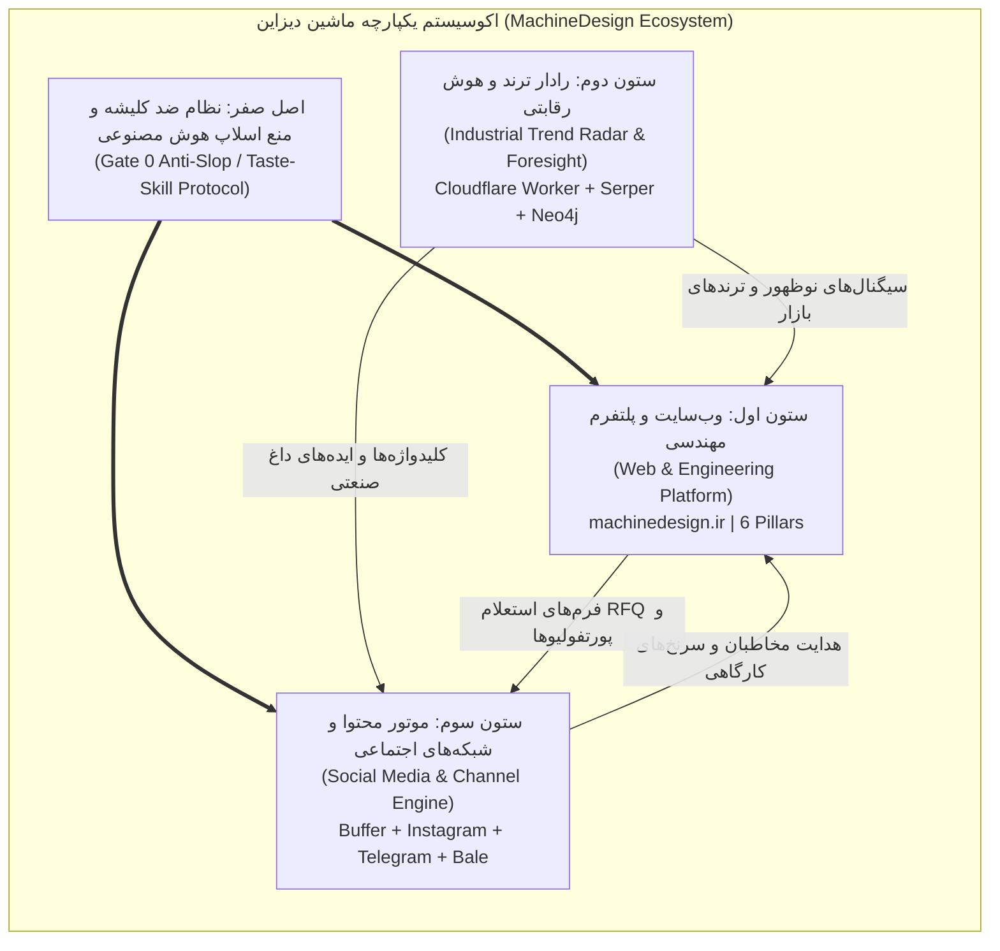

# قانون اساسی جامع و یکپارچه اکوسیستم ماشین دیزاین (Unified Ecosystem Constitution)
**دامنه و برند:** `machinedesign.ir` | **متدولوژی:** Spec-Driven Development (SDD)  
**محیط‌های عملیاتی:** روت پروژه‌ها `D:\Antigravity\` | وب‌سایت محلی `C:\xampp\htdocs\machinedesign\` | استقرار هاست `D:\Machinedesign.ir\cpanel-deploy\`

---

## ۱. بیانیه مأموریت و معماری سه‌گانه اکوسیستم (Trinity Ecosystem Architecture)

اکوسیستم ماشین دیزاین یک زیرساخت یکپارچه صنعتی-فناورانه است که از سه ستون هماهنگ و مکمل تشکیل یافته است. هرگونه توسعه، اصلاح، یا طراحی در هر یک از این سه ستون باید بر اساس متدولوژی توسعه مشخصات‌محور (Spec-Driven Development) و با رعایت اصول این قانون اساسی اجرا شود:

---

## ۲. اصل بنیادین صفر: نظام ضد کلیشه و منع مطلق اسلاپ هوش مصنوعی (Gate 0 Anti-Slop & Anti-Cliché Law)

> [!IMPORTANT]
> **قانون قطعی، دائمی و غیرقابل شکست (Unbreakable Directive):** هیچ صفحه، کامپوننت، سکشن یا فیچری در وب‌سایت ماشین دیزاین هرگز بدون رعایت کامل و سخت‌گیرانه قوانین ضد کلیشه و عبور از دروازه صفر (Gate 0: `design-taste-frontend` / tasteskill v2) پیاده‌سازی، بازطراحی یا مستقر نخواهد شد. هرگونه طراحی مبتنی بر پیش‌فرض‌های کلیشه‌ای هوش مصنوعی (مانند هیروی وسط‌چین با ۳ کارت آیکون‌دار، گرادیان‌های ژنریک بنفش/آبی، سایه‌های معلق ناموجه و کادربندی‌های تو در تو) اکیداً ممنوع بوده و بلافاصله مسدود می‌شود.

### ارکان ۵ گانه دروازه ضد کلیشه (The 5 Anti-Slop Pillars):
1. **سیاهه عینی و فنی سوژه (Subject Inventory):**
   - پیش از طراحی هر صفحه، باید ۸ الی ۱۲ واقعیت فنی ملموس که منحصراً متعلق به این پروژه است استخراج شود (ابعاد قطعات، استانداردهای DIN/ISO/AGMA، تلرانس‌های GD&T، متریال‌ها، نقاط اصطکاک واقعی کارگاه و نیازهای میدانی کارفرما). هرگونه ادعای انتزاعی یا عبارات کلیشه‌ای بازاریابی ممنوع است.
2. **بیانیه ایده اختصاصی (Idea Statement):**
   - برای هر صفحه، یک جمله صریح و بدون ابهام فرموله می‌شود:
     `«در این صفحه، [دارایی یا مکانیزم مکانیکی منحصربه‌فرد سوژه] به [ابزار تعاملی یا بصری صفحه] تبدیل می‌شود.»`
3. **المان زنده تعاملی (One Live Thing):**
   - هر صفحه یا لندینگ باید حداقل دارای یک المان زنده، فیزیک‌محور یا محاسباتی باشد که کاربر بتواند آن را لمس، چرخش یا فیلتر کند (مانند چرخش سه‌بعدی تعاملی مکانیزم با حرکت ماوس، محاسبه‌گر زنده تلرانس، فیلتر آنی دپارتمان‌ها و پورتفولیو، یا داسیر تعاملی RFQ).
4. **غربال استاتیک کد و رفع تخلفات با ابزار لینتر (`npm run taste:lint` یا `taste-lint.bat`):**
   - کلیه کدهای CSS، JS و تمپلیت‌ها باید توسط لینتر اسکن شوند.
   - **خطوط قرمز مسدودکننده (FAILs):**
     - **منع گرادیان‌های ژنریک:** هیچ گرادیان نرم هوش مصنوعی (`linear-gradient` / `radial-gradient`) مجاز نیست مگر اسکرین خنثی روی عکس واقعی.
     - **منع سایه‌های معلق:** هیچ سایه‌ای برای المان‌های ساکن (`box-shadow` در حالت rest) مجاز نیست؛ سایه فقط مختص المان‌های واقعاً شناور لایه‌ای (Overlay/Sticky/Modal) است.
     - **منع خطوط مویی تفکیک‌کننده:** خطوط باریک مویی تفکیک‌کننده غیرضروری (`1px hairline borders`) ممنوع بوده و تفکیک باید با فاصله، تغییر تن رنگی یا مقیاس انجام شود.
     - **منع سوپ کارت‌های تو در تو:** از ایجاد کادرهای تکراری ۱ پیکسلی بدون ساختار سلسله‌مراتبی اجتناب شود.
     - **منع ایموجی به عنوان UI:** استفاده از ایموجی به عنوان آیکون‌های اصلی رابط کاربری اکیداً ممنوع است.
     - **منع گرادیان متن:** متن با گرادیان رنگی کلیشه‌ای (`background-clip: text`) ممنوع است.
5. **ارزیابی تصویری و چندعرضی مرورگر واقعی (`npm run taste:inspect` یا `taste-inspect.bat`):**
   - صفحه در مرورگر واقعی در سه عرض استاندارد (۱۴۴۰ پیکسل دسکتاپ، ۷۶۸ پیکسل تبلت، و ۳۹۰ پیکسل موبایل) تست شده و از عدم برش متن، فقدان هم‌پوشانی و ثبات ریتم ۸ پیکسلی اطمینان حاصل می‌شود.

---

## ۳. ستون اول: وب‌سایت و پلتفرم مهندسی (Web & Engineering Platform)

### ۱. هویت بصری، دارک‌مود سایبری و ریتم متناوب (Cyber-Mechanical Dark & Alternating System)
1. **پالت رنگی مطلق و منع استایل اینلاین:**
   - استفاده از استایل‌های اینلاین (`style="..."`) یا رنگ‌های تصادفی خارج از پالت مهندسی اکیداً ممنوع است.
   - تمامی متغیرها باید منحصراً از `:root` در `style.css` فراخوانی شوند:
     - پس‌زمینه عمیق: `--color-primary-dark: #0a0e17;` (Midnight Abyss)
     - اسلیت صنعتی تیره: `--color-primary: #121824;`
     - رنگ تاکیدی و نئون سازمانی: `--color-accent: #8ce70c;` (سبز لیمویی لیزری)، `--color-accent-dim: rgba(140, 231, 12, 0.12);` و بردر نئونی `--color-accent-border: rgba(140, 231, 12, 0.35);`.
     - رنگ‌های هشدار و وضعیت: `--color-amber: #f59e0b;` و `--color-cyan: #06b6d4;`.
2. **ریتم متناوب صفحات (Alternating Section Themes):**
   - جهت افزایش کنتراست بصری و جلوگیری از خستگی چشم، صفحات طولانی و لندینگ‌ها می‌توانند از ساختار متناوب پیروی کنند: سکشن‌های فرد (Odd) با تم دارک سایبری عمیق و سکشن‌های زوج (Even) با تم اسلیت روشن صنعتی (`#f8fafc` با کارت‌های سفید `#ffffff` و بوردرهای نئونی).
3. **تایپوگرافی رسمی و تفکیک دوزبانه:**
   - **فارسی:** تمامی عناوین و متون بدنه منحصراً با فونت **وزیرمتن (Vazirmatn)** در وزن‌های ۳۰۰ تا ۹۰۰ با ویژگی `font-feature-settings: "ss01"`.
   - **ممنوعیت مطلق `letter-spacing` در متون فارسی:** کلیه متون، تیترها، دکمه‌ها و بج‌های فارسی باید دارای `letter-spacing: 0` باشند تا از گسستگی حروف چسبان فارسی جلوگیری شود. فاصله حروف فقط مختص کدهای تماماً انگلیسی و کلاس‌های `.mono` است.
   - **استاندارد املای واژگان تخصصی مهندسی:** در تمامی متون فارسی، نگارش «سالیدورکس» (با س پایانی) الزامی است. واژگان مشتق از مدل‌سازی منحصراً با نیم‌فاصله (ZWNJ) درج می‌شوند («مدل‌سازی»، «مدل‌سازی سه‌بعدی»، «مدل‌سازی‌شده»).
   - **لاتین و کدهای فنی:** تمامی کدهای قطعات، استانداردهای DIN/ISO/AGMA، تلرانس‌های GD&T و اعداد فنی منحصراً با فونت **JetBrains Mono** در کلاس `.mono` با جهت `direction: ltr`.
   - **سلسله‌مراتب استوار هدینگ‌ها:** در هر صفحه دقیقاً یک `<h1>` در هیرو، عناوین سکشن‌های اصلی و فرم استعلام با `<h2>`، و کارت‌های ماژول، گام‌های نقشه راه و مقایسه‌ها با `<h3>`.
   - **نرمال‌سازی ارقام تماس:** فیلدهای ورودی تماس (`tel`, `phone`, `mobile`) با Event Delegation سراسری بدون تغییر مکان‌نما بلادرنگ از ارقام فارسی/عربی به انگلیسی (`0-9`) تبدیل می‌شوند.
   - **توکن‌های افزایشی کنتراست:** استفاده از کلاس‌های کمکی سراسری `.md-on-light-title` (`#0F172A`)، `.md-on-light-body` (`#334155`)، `.md-on-light-accent` (`#15803D`) در سطوح روشن و `.md-on-dark-body` (`#CBD5E1`) در سطوح تیره.
4. **تقارن بصری و تراز خط مبنا (Baseline & Split Symmetry):**
   - **تقارن دو ستونه تصویر و متن (2-Column Image-Text Split):** گرید با `align-items: stretch` و قاب تصویر با `img { height: 100%; object-fit: cover; }` به گونه‌ای که تصویر دقیقاً به اندازه ستون متن کشیده شود و انحراف خط مبنا ۰.۰۰ پیکسل باشد.
   - **تقارن اجزای پایانی ستون‌ها:** در صورت وجود چیپ یا دکمه در کف یک ستون، ستون مقابل نیز باید المان پایانی با ارتفاع و تراز پیکسلی دقیقاً یکسان داشته باشد.
   - **معماری پوشش تصویر (Zero-Overlap Overlay):** حداکثر یک بج شیشه‌ای یکپارچه صنعتی (HUD Glass Badge) در لبه پایین تصویر تعبیه شود و از انباشت بج‌های متعدد خودداری گردد.
   - **اصل عدم رقابت CTA (Zero Competing CTA Rule):** در سکشن‌های استعلام تخصصی خدمات، قرار دادن دکمه‌های موازی یا ارجاع به صفحه تماس عمومی (مانند «استعلام متمرکز») اکیداً ممنوع است. هر صفحه مستقیماً به تماس مستقیم کارشناس یا ثبت فرم همان صفحه منتهی می‌شود.
   - **الزام گزینه پیش‌فرض غیرفعال در فرم‌ها:** تمامی فیلدهای `<select>` باید دارای `<option value="" disabled selected>انتخاب ...</option>` باشند تا از ثبت تصادفی بدون انتخاب آگاهانه کاربر جلوگیری گردد.
   - **سئوی دینامیک عناوین و نقشه سایت وردپرس:** متاتگ عنوان صفحات منحصراً از طریق فیلترهای استاندارد وردپرس در `functions.php` کنترل شده و زیر ۶۰ کاراکتر حفظ می‌شود. نقشه سایت در فوتر با `esc_url( home_url( '/wp-sitemap.xml' ) )` متصل می‌گردد.
   - **اطلاعات تماس متمرکز تم:** شماره‌های تماس و ایمیل‌ها از طریق هلپر `md_get_contact()` و تابع نرمال‌سازی پیوند `md_tel_uri()` فراخوانی می‌شوند و مقادیر آزمایشی با `/* TODO: REAL_CONTACT */` علامت‌گذاری می‌گردند.
   - **قانون سکشن‌های ایزوله و استایل‌دهی تک‌فایلی (Scoped Component & Single-File Rule):** در وظایف محدود به یک صفحه تمپلیت خاص، کلیه استایل‌ها زیر کلاس متمایز کامپوننت با پیشوند .md- و در بلوک <style> اختصاصی در بالای همان سکشن در فایل تمپلیت اسکوپ می‌شوند تا شرط ویرایش تک‌فایلی با صفر رگرسیون برآورده شود.
   - **کنتراست کارت‌های تیره و دکمه‌های CTA (استاندارد WCAG AA):** تیترهای داخل کارت‌های تیره منحصراً #FFFFFF !important; (وزن ۸۰۰)، پاراگراف‌ها #CBD5E1 !important; و متن دکمه‌های سبز برند #8ce70c الزاماً تیره سازمانی #0F172A !important; (وزن ۸۰۰ با کنتراست بالای ۹:۱) هستند.
   - **رفع باگ سلکتور کشویی کروم در ویندوز:** اعمال صریح ackground-color: #FFFFFF !important; color: #0F172A !important; بر روی گزینه‌های <option> در تمام فرم‌ها جهت پیشگیری از رندر سفید روی سفید.
   - **سازگاری قطعی با لینتر Gate 0:** قرار دادن متون مونواسپیس فنی در تگ‌های بومی <code> و حاشیه‌نویسی خطوط بردر ظریف یا اسکریم تصویر با کامنت /* taste-skill-ignore */ جهت حفظ همیشگی نتیجه  FAIL.

### ۲. استیج‌های سه‌بعدی سبک و ویدیوی وب (Resource Economy & 3D Web)
- فریمورک‌های سنگین 3D JS یا پکیج‌های حجیم ممنوع است. مکانیزم‌ها از طریق GPU-accelerated CSS 3D transforms (`perspective(1100px) rotateX/Y`) و اینرسی نرم Lerp اجرا می‌شوند.
- فرمت ویدیوهای شفاف متحرک: **Transparent WebM** (کدک VP9 با کانال `yuva420p`، فریم‌ریت ۲۰ تا ۲۴ و CRF بین ۳۶ تا ۳۸ با حجم زیر ۴۰۰ کیلوبایت).
- پخش ویدیوها درون حافظه و روی `<canvas>` بدون نمایش دکمه‌های مزاحم اکستنشن‌های دانلودر (مثل IDM).

### ۳. ساختار صفحات، تیم بنتو و خدمات ۶ گانه
- پایگاه اصلی خدمات ۶ گانه مهندسی: طراحی خطوط تولید (DFMA)، عیب‌یابی خط و ارتعاشات، R&D و نمونه‌سازی، آموزش فردی، آموزش سازمانی، کارشناسی خرید از چین/دبی.
- گرید معرفی تیم ۱۶ نفره بنتو در صفحه `/about/team/` با فیلتر لحظه‌ای دپارتمان‌ها و موتور جستجوی کلاینت‌ساید و پیوند مستقیم به پورتفولیوی اختصاصی هر مهندس.

---

## ۴. ستون دوم: رادار ترند صنعتی و هوش رقابتی (Cloudflare Trend Radar & Foresight)

### ۱. زیرساخت ابری کلودفلیر و پایگاه داده KV
- ورکر ابری: `industrial-trend-radar`
- آدرس عمومی: `https://industrial-trend-radar.hosseinvatandoust699.workers.dev`
- کلید احراز هویت اختصاصی API: `machinedesign_radar_2026`
- پایگاه داده: Cloudflare KV با شناسه `1b9878760547449cab280666ba30604d` (`TREND_RADAR_KV`)
- اکانت کلودفلیر: `3f56465f200e976cce193076bd720b1c`

### ۲. مکانیزم پایش چرخشی متوازن (Stratified Interleaved Round-Robin Cursor)
- **چرخه کرون‌جاب ورکر:** اجرا در ساعت‌های `0 4 * * *` و `30 4 * * *` (UTC).
- **پایش لایه‌ای ۴ فازی:** در هر دور اجرا، بذرها به صورت لایه‌ای متوازن از میان تمامی ۶ ستون خدمات چرخیده و انتخاب می‌شوند؛ ۱۰۰٪ بذرهای ۱۴۰گانه ظرف ۴۸ ساعت اسکن کامل می‌گردند.
- **سقف سخت ساب‌ریکوئست‌ها:** ساب‌ریکوئست‌های ورکر همواره بین ۳۸ تا ۴۴ حفظ می‌شوند تا تحت هیچ شرایطی به سقف مجاز ۵۰ کلودفلیر برخورد نکند.

### ۳. قانون استفاده بهینه از سهمیه‌های رایگان (70% Quota Rule)
- مصرف سهمیه سرویس‌های ابری رایگان (Google Custom Search تا ۷۰ کوئری روزانه، کلودفلیر KV تا ۱۰۰,۰۰۰ خواندن روزانه) باید همواره تا سقف ۷۰ الی ۹۰ درصد مصرف نگه داشته شود تا حداکثر بینش تجاری استخراج گردد بدون آنکه هزینه‌ای پرداخت شود.

### ۴. لایه هوش رقابتی SERP و نتایج ارگانیک گوگل (SERP Intelligence v4.1 via Serper.dev)
- اتصال مستقیم به سرورهای رسمی Serper.dev جهت استخراج سازنده رتبه ۱، لینک‌ها، چکیده‌ها و سوالات متداول People Also Ask.
- ذخیره در بلوک `serp` با کش ۷ روزه (7-Day TTL) و بودجه‌بندی روزانه حداکثر ۷۰ کوئری.

### ۵. همگام‌سازی لوکال و گزارش هفتگی تلگرام (Catch-up & Weekly Dispatch)
- اسکریپت همگام‌سازی بلادرنگ لوکال: `D:\Antigravity\trend_radar\check_weekly_catchup.py` و ذخیره وضعیت در `catchup_state.json`.
- ارسال خودکار ۵ ترند برتر هفته در کرون‌جاب `0 5 * * 6` (شنبه‌ها ساعت ۰۸:۳۰ صبح تهران) مستقیماً به تلگرام شخصی حسین (`@Hoseinvatandoust` / Chat ID `7280306397`).

### ۶. اتصال به گراف دانش آینده‌پژوهی در Neo4j AuraDB
- اتصال به پایگاه ابری Neo4j AuraDB (Instance ID: `2bc9ca8b`) از طریق اسکیل `neo4j-graph-navigator`.
- نگاشت سیگنال‌های ضعیف (Weak Signals)، ماتریس تاثیر متقابل (Cross-Impact Matrix) و چرخ‌های آینده (Futures Wheels) به ستون‌های ۶ گانه خدمات.

---

## ۵. ستون سوم: موتور محتوا و شبکه‌های اجتماعی (Social Media & Channel Engine)

### ۱. معماری کانال‌ها و قیف محتوایی (Multi-Channel Funnel)
- **اینستاگرام شخصی/کریتور (`@h.vatan.doust`):** کانال لید و خط مقدم برای ماشین‌آلات، ویدیوهای کارگاهی، تجربیات میدانی و فرم‌های تعاملی.
- **اینستاگرام بیزینسی (`@machinedesign.ir`):** پایگاه رسمی برند مهندسی، معرفی پروژه‌ها و بازنشر مشارکتی (Collaborator Tag در اسلاید ۱).
- **تلگرام و بله (`@machinedesign_ir`):** پایگاه فایل، استانداردهای صنعتی DIN/ISO، نقشه‌ها، و فرم‌های RFQ.
- **بله «از پرامپت تا محصول» (`@prompt2product`):** کاملاً مستقل از ماشین دیزاین و متمرکز بر هوش مصنوعی مولد.

### ۲. اولویت قطعی سیستم انتشار Buffer MCP (Queue Hygiene)
- بافر (`hosseinvatandoust699@gmail.com`) اولویت اول و قطعی انتشار است.
- پیش از زمان‌بندی هر پست جدید، صف با دستور `list_posts` بازبینی شده و پیش‌نویس‌های قدیمی با `delete_post` پاکسازی می‌شوند.

### ۳. معماری تولید بصری با شیت یکپارچه (`image-generator` Single-Grid Master Sheet)
- **ممنوعیت مطلق کدنویسی تصاویر با PIL یا Canvas:** کلیه اسلایدهای بصری منحصراً توسط ساب‌ایجنت `image-generator` خلق می‌شوند.
- **پایپ‌لاین مسترشیت تک‌شبکه‌ای:** برای صرفه‌جویی در کوئری و تضمین ۱۰۰٪ هماهنگی بصری و رنگی، اسلایدهای کاروسل در قالب یک تصویر جامع شبکه‌ای (Master Grid) تولید شده و سپس با اسکریپت پایتون بدون درز به اسلایدهای ۱۰۸۰×۱۳۵۰ برش می‌خورند.
- **هویت بصری الزامی:** منحصراً تم دارک سایبری-مکانیکی با رنگ نئون سبز سازمانی (`#8ce70c`)، پترن‌های وکتور CAD و تایپوگرافی فارسی وزیرمتن بدون کشیدگی حروف (Zero Kashida).

### ۴. دکترین رازداری و حفاظت از اسرار مهندسی (Trade Secret Commercial Doctrine)
- **افشای نقشه‌های داخلی، کالبدشکافی مکانیسم یا نسبت دنده‌ها اکیداً ممنوع است.**
- برتری فنی همیشه به عنوان راز تجاری اختصاصی معرفی می‌شود: *«ما سال‌ها روی قلق‌های مهندسی این دستگاه کار کرده‌ایم؛ این رازها و فرمول‌های طلایی منحصراً به خریداران آموزش داده می‌شود تا فرسنگ‌ها از رقبایشان جلوتر باشند.»*

### ۵. استقرار جغرافیایی و واقع‌گرایی صنعتی (Grounding & Anti-Hallucination)
- **موقعیت رسمی:** دفتر مرکزی و کارگاه تست زنده منحصراً **مشهد، برج سامان (میدان جانباز)** است. انتساب کارگاه به تهران اکیداً ممنوع است.
- **قالب‌های روتاری دستگاه:** قالب‌های دستگاه پیراشکی/دامپلینگ Konbrit KBDM-150 منحصراً **قالب‌های استوانه‌ای روتاری برنجی/برنزی تراشکاری‌شده با CNC** هستند. هرگونه قالب مسطح یا کاتر کوکی تخیلی ممنوع است.
- **ظرفیت تولید واقعی:** ظرفیت متغیر بین ۱,۰۰۰ تا ۱۰,۰۰۰ عدد در ساعت متناسب با ابعاد محصول و آرایش نیروی انسانی.
- **اپراتور انسانی:** نمایش بانوی کارآفرین و اپراتور واقعی ایرانی در محیط کارگاهی ملموس با پوشش بهداشتی حرفه‌ای.

---

## ۶. ماتریس فراخوانی خودکار اسکیل‌ها (Zero-Prompt Skill Orchestration)

کاربر هرگز نیازی به یادآوری یا فراخوانی دستی اسکیل‌ها ندارد؛ سیستم بر اساس ماهیت تسک به صورت خودکار زنجیره اسکیل‌ها را فعال می‌کند:

| دامنه عملیاتی | اسکیل‌های درگیر به ترتیب اولویت | خروجی مورد انتظار |
| :--- | :--- | :--- |
| **تصمیم‌گیری هنری و ضد اسلاپ** | `design-taste-frontend` (Gate 0) | استخراج Subject Inventory، تدوین Idea Statement، انتخاب One Live Thing و اجرای `taste:lint` |
| **طراحی سکشن‌های وب** | `section-scout-builder` + `automattic-wp-architect` + `graphic-design-aesthetics` | کشف ۳-۴ کامپوننت مدرن، تایید انسانی، شبکه ۸ پیکسلی و تباین WCAG 2.1 AA |
| **سئو و محتوای وب** | `seo-content-brief` + `seo` + `seo-schema` + `seo-technical` | اسکن کلیدواژه‌های Autoclaw، تزریق JSON-LD و رعایت ساختار هدینگ‌ها |
| **کدنویسی چابک** | `ponytail` (Lazy Senior Dev Mode) | کوتاه‌ترین، تمیزترین و کم‌ریسک‌ترین دیف کد بدون پکیج‌های سربار |
| **توسعه افزونه، قالب و تنظیمات وردپرس** | `wp-plugin-development` + `wp-block-development` + `wp-performance` + `wp-rest-api` + `wordpress-router` | پیاده‌سازی با Settings API، نانس‌های ضد CSRF، مجوزهای دسترسی، Sanitization/Escaping و معماری لود سبک |
| **پایش ترند و هوش رقابتی** | `machinedesign-trend-radar` + `neo4j-graph-navigator` | اسکن ورکر، تطبیق با ۶ ستون، گزارش تلگرام و به‌روزرسانی گراف دانش |
| **تولید محتوا و گرافیک سوشیال** | `machinedesign-artifact-designer` + `machinedesign-social-workflow` + `image-generator` | شیت‌های یکپارچه ۴:۵ و استوری‌های ۹:۱۶ با رنگ `#8ce70c` و فرمت Buffer |
| **صداگذاری و دوبله ویدیوها** | `smart-video-dubbing` | دوبله دقیق ویدیوهای صنعتی خارجی به فارسی با Gemini 3.8 Flash TTS و Ducking صدا |
| **مدیریت پروژه و هماهنگی ترلو** | `machinedesign-project-manager` + `trello-use` | اولویت‌بندی تسک‌ها، کنترل سهمیه‌ها و همگام‌سازی خودکار بورد ترلو |
| **ممیزی اسناد و سلامت معماری** | `speckit-analyze` (Pre-flight Gate) | تحلیل سازگاری بین سه سند spec، plan و tasks و رفع تضاد با قانون اساسی |
| **همگرایی و بستن شکاف‌های کد** | `speckit-converge` (Post-implementation) | مقایسه سورس‌کد نهایی با الزامات و الحاق خودکار کارهای باقیمانده به tasks.md |
| **کنترل کیفیت لوکال** | XAMPP QA (`php -l`, localhost test, zero-overflow) | بدون خطای سینتکس، بدون سرریز افقی و بروزرسانی `cpanel-deploy` |

---

## ۷. پروتکل چرخه توسعه مشخصات‌محور (Unified SDD Lifecycle)

برای هر تغییر، فیچر، ماژول، یا کمپین جدید در هر یک از سه ستون اکوسیستم، چرخه مهندسی زیر به صورت خودکار و بدون نیاز به پرامپت دستی در پوشه مربوطه در `specs/` اجرا می‌شود:

1. **سنجش وضعیت اولیه:** اجرای خودکار `check-prerequisites.ps1` جهت ارزیابی مدارک موجود.
2. **/speckit-specify (`specs/<feature>/spec.md`):** تبیین مشخصات عملکردی، بیزینس‌پلن، نیت کاربر، عبور از دروازه هنر و ضد اسلاپ Gate 0 و سناریوهای مستقل تست.
3. **/speckit-plan (`specs/<feature>/plan.md`):** تدوین طرح فنی، معماری فایل‌ها، وابستگی‌ها، ممیزی چک‌لیست Gate 0 و تمپلیت‌ها.
4. **/speckit-tasks (`specs/<feature>/tasks.md`):** تفکیک طرح به تسک‌های ریز، مستقل و دارای ترتیب وابستگی منطقی با فاز اختصاصی برای `taste:lint` و تست بصری.
5. **/speckit-analyze (ممیزی پیش از کدنویسی):** بازبینی خودکار عدم تضاد میان سه سند و انطباق ۱۰۰٪ با قانون اساسی.
6. **/speckit-implement:** اجرای گام‌به‌گام کدها، تست میدانی، راستی‌آزمایی لوکال و پاس شدن لینتر.
7. **/speckit-converge (سنجش نهایی انطباق):** سنجش خودکار سورس‌کد با مشخصات سند و الحاق کارهای باقیمانده به عنوان فاز همگرایی تا تحویل کامل بدون باگ.

---

## ۸. حاکمیت و اعتبار (Governance)

- این سند، قانون اساسی فراگیر و مرجع عالی اکوسیستم ماشین دیزاین است و بر تمامی فرآیندهای کدنویسی، ترندیابی و تولید محتوا حاکمیت دارد.
- هرگونه بازنگری مستلزم تغییر شماره نسخه، ثبت مستند و تایید کارفرما (حسین وطن‌دوست) است.

**نسخه:** 2.1.0 | **تاریخ تصویب:** 2026-11-01 | **وضعیت:** فعال، رسمی و لازم‌الاجرا
